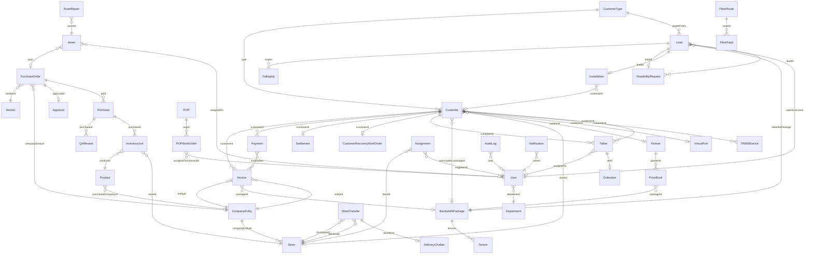

# Cityline ISP Platform — Domain Model

> Generated from static analysis of `src/data/*Store.js`, `*Data.js`, and `src/utils/`.
> **Read-only. No code was modified.**

---

## Table of Contents

1. [Domain A — Sales](#domain-a--sales)
2. [Domain B — Customer & Billing](#domain-b--customer--billing)
3. [Domain C — Support](#domain-c--support)
4. [Domain D — Inventory](#domain-d--inventory)
5. [Domain E — Assets](#domain-e--assets)
6. [Domain F — Network & Infrastructure](#domain-f--network--infrastructure)
7. [Domain G — Projects](#domain-g--projects)
8. [Domain H — Intercom](#domain-h--intercom)
9. [Domain I — Partners & Pricing](#domain-i--partners--pricing)
10. [Domain J — Admin & Config](#domain-j--admin--config)
11. [Section A — Entity-Relationship List by Domain](#section-a--entity-relationship-list-by-domain)
12. [Section B — Mermaid erDiagram](#section-b--mermaid-erdiagram)
13. [Section C — Business Rules That Must Move to Backend](#section-c--business-rules-that-must-move-to-backend)

---

## Domain A — Sales

### Entity: Lead
**Source:** `src/data/leadsStore.js`

| Field | Type | Required | Example | Notes |
|---|---|---|---|---|
| id | string | Y | `LD-201`, `RES-2026-001` | Legacy: `LD-NNN`; new: `{leadIdPrefix}-{YYYY}-{NNN}` from CustomerType config |
| pipeline | enum | Y | `'B2C'` | `'B2C' \| 'Enterprise' \| 'Custom'` |
| name | string | Y | `'Ramesh Nair'` | Contact name |
| phone | string | Y | `'9876543210'` | |
| email | string | N | `'ramesh@gmail.com'` | |
| area | string | N | `'Andheri West'` | |
| source | string | N | `'Referral'` | Lead source channel |
| stage | string | Y | `'Feasibility'` | Controlled by pipeline (see stage lifecycle) |
| plan | string | N | `'100 Mbps'` | Denormalized from selectedPackage |
| assigned | string | N | `'Arjun Kumar'` | Display name — denormalized from user |
| salesExecutive | string | N | `'u1'` | FK → User.id |
| assignedInitials | string | N | `'AK'` | Derived, stored for display; **do not store** |
| assignedColor | string | N | `'#4F46E5'` | Avatar color seed |
| daysInStage | number | N | `3` | **Computed** from stageHistory; **do not store** |
| lastActivity | string | N | `'2 days ago'` | **Computed**; **do not store** |
| followUp | date | N | `'2026-11-01'` | YYYY-MM-DD |
| priority | enum | N | `'high'` | `'high' \| 'medium' \| 'low'` |
| ekycStatus | string/null | N | `null` | |
| createdAt | ISO timestamp | Y | `'2026-10-01T10:00:00Z'` | |
| createdBy | string | N | `'u1'` | FK → User.id |
| address | object | N | see below | |
| city / pincode / state / district | string | N | | Part of address |
| locality / subLocality | string | N | | |
| siteType / branchCode | string | N | | From AreaMapping |
| alternateMobile | string | N | | |
| stageHistory | array | N | `[{stage, movedAt, movedBy, note}]` | Audit trail; append-only |
| selectedPackage | object/null | N | | Resolved BandwidthPackage ref |
| bandwidthPackage | object | N | | Enterprise bandwidth approval object |
| kycDocs | object | N | `{aadhaar, pan, photo}` | File references |
| companyName | string | N | | Corporate only |
| contactPerson | string | N | | Corporate only |
| gstRegistered | bool | N | | Corporate only |
| gstNumber | string | N | | Corporate only |
| companyAddress | string | N | | Corporate only |
| hwAssigned | null | N | | Placeholder; always null in current data |

**Stage lifecycle — B2C:** New Inquiry → Contacted → Follow-up → Feasibility → Installation Visit → Won / Lost
**Stage lifecycle — Enterprise:** New Inquiry Filed → Discussion → Follow-up → Proposal → Won / Lost

**Stage gates (enforced in `leadsStore.js:canMoveLeadToStage`):**
- B2C "Won" cannot be set manually
- B2C "Installation Visit" requires FeasibilityRequest.status = 'Approved'
- Enterprise "Won" allowed only from "Proposal"

**Derived (do not store):** `daysInStage`, `lastActivity`, `assignedInitials`

**Relationships:**
- `salesExecutive` N:1 → User
- `selectedPackage.id` N:1 → BandwidthPackage
- Lead 1:0..1 → FeasibilityRequest
- Lead 1:0..1 → Installation
- Lead 1:0..N → FollowUp

---

### Entity: FeasibilityRequest
**Source:** `src/data/feasibilityStore.js`

| Field | Type | Required | Example | Notes |
|---|---|---|---|---|
| id | string | Y | `'FR-001'` | `FR-NNN` sequential |
| leadId | string | Y | | FK → Lead.id |
| customerName | string | Y | | Denormalized |
| mobile | string | Y | | Denormalized |
| feasibilityStatus | enum | Y | `'Pending'` | `'Pending' \| 'Approved' \| 'Rejected'` |
| timeline | array | N | `[{status, note, timestamp, updatedBy}]` | Audit trail |

**Business rule:** When status → 'Approved' and linked lead stage ≤ 'Feasibility', lead auto-advances to 'Installation Visit' (`feasibilityStore.js:updateFeasibilityStatus`).

---

### Entity: Installation
**Source:** `src/data/installationsStore.js`

| Field | Type | Required | Example | Notes |
|---|---|---|---|---|
| id | string | Y | `'INS-001'` | `INS-NNN` sequential |
| leadId | string/null | N | `'LD-201'` | FK → Lead.id; nullable after customer created |
| customerId | string/null | N | `'RES-2026-0001'` | FK → Customer.id; set after conversion |
| status | enum | Y | `'Scheduled'` | See lifecycle |
| statusHistory | array | N | `[{status, timestamp, updatedBy}]` | Audit trail |
| scheduledAt | ISO timestamp | N | | |
| assignedEngineer | string | N | | FK → User/engineer |
| teamId | string | N | | FK → InstallationTeam |

**Status lifecycle:** Scheduled → Assigned → Hardware Collection Pending → Dispatched → Completed; also: Rescheduled, Cancelled (terminal)

---

### Entity: FollowUp
**Source:** `src/data/followupStore.js`

| Field | Type | Required | Example | Notes |
|---|---|---|---|---|
| id | string | Y | `'FU-001'` | `FU-NNN` sequential |
| leadId | string | Y | `'LD-201'` | FK → Lead.id |
| leadName | string | Y | | Denormalized |
| customer | string | Y | | Denormalized display name |
| pipeline | string | Y | `'Residential'` | |
| phone | string | Y | | Denormalized |
| priority | enum | Y | `'high'` | `'high' \| 'medium' \| 'low'` |
| status | enum | Y | `'Pending'` | `'Pending' \| 'Overdue' \| 'Done'` |
| dueDate | date | N | `'2026-10-30'` | |
| notes | string | N | | |

**Derived (do not store):** `status = 'Overdue'` when `dueDate < today && status != 'Done'`

---

### Entity: EkycRecord
**Source:** `src/data/ekycRecordsStore.js`

| Field | Type | Required | Example | Notes |
|---|---|---|---|---|
| identifier | string | Y | Aadhaar/PAN number | Normalized for lookup |
| name | string | Y | | |
| dob | string | N | | |
| address | string | N | | |
| photo | string | N | | URL/base64 |

**Lookup:** `findEkycRecord(identifier)` normalizes to uppercase alphanumeric.

---

### Entity: IntercomLead
**Source:** `src/data/intercomLeadsStore.js`

| Field | Type | Required | Example | Notes |
|---|---|---|---|---|
| id | string | Y | `'IC-LEAD-2026-000001'` | `IC-LEAD-YYYY-NNNNNN` |
| type | enum | Y | `'Internet + Intercom'` | `'Internet + Intercom' \| 'Intercom Only'` |
| name / phone / email | string | Y/Y/N | | |
| area / address | string | N | | |
| stage | string | Y | | Similar pipeline to B2C |
| createdAt | ISO | Y | | |

---

### Entity: Pipeline (config)
**Source:** `src/data/pipelineStore.js`

| Field | Type | Required | Notes |
|---|---|---|---|
| id | string | Y | `PL-001`, `PL-003` |
| name | string | Y | `'Residential'`, `'Enterprise'` |
| activeLeads | number | N | Denormalized count — **do not store** |
| stages | array | Y | See Stage sub-entity |

**Stage sub-entity fields:** id, name, color, required (bool), type (`'Standard'`), active (bool), statusType (`'Open' \| 'Won' \| 'Lost'`), followUpAllowed (bool)

---

## Domain B — Customer & Billing

### Entity: Customer
**Source:** `src/data/customersData.js`

| Field | Type | Required | Example | Notes |
|---|---|---|---|---|
| id | string (PK) | Y | `'RES-2026-0001'` | ID format by type (see below) |
| name | string | Y | `'Ramesh Nair'` | |
| phone | string | Y | `'9876543210'` | |
| plan | string | Y | `'100 Mbps'` | **Denormalized** from subscription.packageName |
| status | enum | Y | `'active'` | See lifecycle below |
| zone / area | string | N | `'West Zone'` | |
| network | string | N | `'192.168.1.0/24'` | |
| expiry | date | Y | `'2026-11-30'` | **Denormalized** from subscription.expiry (YYYY-MM-DD) |
| services | string[] | N | `['Broadband', 'Landline']` | ServiceTag names |
| cafStatus | enum | N | `'Approved'` | `'Pending' \| 'Submitted' \| 'Rejected' \| 'Approved'` |
| createdOn | string | Y | `'01 Oct 2026'` | Display-format join date `'DD Mon YYYY'`; **do not store as Date** |
| storeId | string | N | | FK → Store.id |
| partnerId | string/int | N | | FK → Partner.id |
| companyName | string | N | | Corporate only |
| gstNo | string | N | `'27AAAAA0000A1Z5'` | Corporate only |
| gstVerified | bool | N | | Corporate only |
| type | string | N | `'resident' \| 'corporate'` | CustomerType.id reference |
| creditBalance | number | N | `200.00` | Overpayment balance; reduced on next invoice |
| statusChangedAt | ISO timestamp | N | `'2026-10-01T09:00:00Z'` | Set on every status change; used in churn analytics |
| disconnectedAt | ISO timestamp | N | | Set when status = 'Disconnected' |

**Nested: subscription**
| Sub-field | Type | Notes |
|---|---|---|
| packageId | string | FK → BandwidthPackage.id |
| packageName | string | Denormalized |
| tenureDays | number | |
| price | number | |
| gstRate | number | |
| hsnSac | string | |
| startDate | date | YYYY-MM-DD |
| expiry | date | YYYY-MM-DD |
| status | enum | `'active' \| 'suspended' \| 'expired'` |
| addons | array | VAS addon refs |

**Customer ID formats:**
- Residential: `RES-YYYY-NNNN` (4-digit, from CustomerType 'resident' config)
- Corporate: `ENT-YYYY-NNNN`
- Intercom: `IC-CUST-YYYY-NNNNNN`
- Legacy fallback: `CL-NNNN`

**Status lifecycle:** `Pending Activation` → `active` → `suspended` / `expired` / `Pending Disconnection` → `Disconnected`; also `inactive`

**Derived (do not store):**
- `effectiveStatus()` — overrides `'active'` to `'expired'` when `customer.expiry < today` (`customersData.js:effectiveStatus`)
- PPPoE ID and App Password — computed from CustomerType pattern substitution (`customerTypes.js:getPPPoEId`, `getAppPassword`)

**Disconnection gate (enforced in `customersData.js:updateCustomer`):**
- `patch.status === 'Disconnected'` requires both `isRecoveryResolvedForCustomer(id)` (hardware) AND `hasSettlementForCustomer(id)` (billing)

**Duplicated data flags:**
- `plan` duplicates `subscription.packageName`
- `expiry` duplicates `subscription.expiry`
- `status` appears on both Customer and Customer.subscription

---

### Entity: CustomerType
**Source:** `src/data/customerTypes.js`

| Field | Type | Required | Notes |
|---|---|---|---|
| id | string | Y | `'resident'`, `'corporate'` |
| name | string | Y | |
| status | enum | Y | `'Active' \| 'Inactive'` |
| systemSeeded | bool | Y | |
| leadIdPrefix | string | Y | `'RES'`, `'ENT'` |
| includeYearInNumber | bool | Y | |
| startingNumber | number | Y | |
| sequencePadding | number | Y | |
| lastIssuedSequence | number/null | Y | **Mutable counter** — must be DB sequence |
| customerIdConfig | object | Y | {prefix, includeYear, startingNumber, sequencePadding, lastIssuedSequence} |
| pppoeIdConfig | object | N | {mode, pattern} — pattern uses `{customerId}` token |
| appPasswordConfig | object | N | {mode, pattern} |
| zohoSyncEnabled | bool | N | |
| tallySyncEnabled | bool | N | |
| eInvoicingEnabled | bool | N | |

**Sequence functions:** `getNextLeadIdSequence(id)` and `formatLeadId/formatCustomerId` mutate `lastIssuedSequence` — **must be atomic DB operation** to avoid duplicate IDs.

---

### Entity: Invoice
**Source:** `src/data/invoicesStore.js`

| Field | Type | Required | Example | Notes |
|---|---|---|---|---|
| no | string (PK) | Y | `'INV-2026-0001'` | Generated by `companyEntities.js:getNextInvoiceNumber` |
| customerId | string | Y | | FK → Customer.id |
| entityId | string | N | | FK → CompanyEntity.id |
| packageId | string | N | | FK → BandwidthPackage.id |
| pkg | string | N | | **Denormalized** packageName (same as packageName below) |
| packageName | string | N | | Denormalized |
| date | string | Y | `'01 Oct 2026'` | Display string; **derived** from issueDate — **do not store** |
| issueDate | date | Y | `'2026-10-01'` | YYYY-MM-DD |
| dueDate | date | Y | `'2026-10-15'` | YYYY-MM-DD |
| lines | array | Y | see InvoiceLine | |
| taxableAmount | number | Y | `847.46` | |
| cgst | number | Y | `76.27` | 9% intra-state |
| sgst | number | Y | `76.27` | 9% intra-state |
| igst | number | Y | `0` | 18% inter-state (mutually exclusive with CGST/SGST) |
| amount | number | Y | `1000` | **Denormalized** total = taxableAmount + tax; same as totalAmount |
| totalAmount | number | Y | `1000` | |
| status | enum | Y | `'pending'` | `'paid' \| 'pending' \| 'cancelled' \| 'partially_paid'` |
| paidOn | date | N | `'2026-10-05'` | YYYY-MM-DD |
| paymentMode | string | N | `'Online'` | |
| txnId | string | N | | |
| creditApplied | number | N | `200` | Auto-applied from customer.creditBalance |
| amountPaid | number | N | | |
| createdAt | ISO | N | | |

**InvoiceLine sub-entity:**
| Field | Type | Notes |
|---|---|---|
| description | string | |
| quantity | number | |
| unitPrice | number | |
| amount | number | = quantity × unitPrice |
| hsnSac | string | HSN/SAC code for GST |

**Business rule:** `addInvoice()` auto-applies customer `creditBalance`, auto-marks 'paid' if credit ≥ total (`invoicesStore.js:addInvoice`).

**Derived (do not store):** `getOutstandingTotal(customerId)`, `getCollectedTotal()`, `getOverdueTotal()` — all computed from invoice list aggregation.

**Duplicated data:** `pkg` duplicates `packageName`; `amount` duplicates `totalAmount`; `date` (display string) derived from `issueDate`.

---

### Entity: Payment
**Source:** `src/data/paymentsStore.js`

| Field | Type | Required | Example | Notes |
|---|---|---|---|---|
| id | string (PK) | Y | `'PAY-1698765432100'` | `PAY-{timestamp}` |
| customerId | string | Y | | FK → Customer.id |
| receiptNo | string | Y | `'RCP-2026-0001'` | Sequential receipt number |
| invoiceNo | string | N | `'INV-2026-0001'` | Single invoice ref (legacy); use invoiceNos |
| invoiceNos | string[] | N | `['INV-2026-0001']` | FKs → Invoice.no |
| paymentDate | string | Y | `'01-10-2026'` | DD-MM-YYYY |
| date | string | Y | `'01-10-2026 10:30:00'` | DD-MM-YYYY HH:MM:SS (full timestamp) |
| mode | enum | Y | `'Cash'` | `'Cash' \| 'Online' \| 'Android App' \| 'Cheque' \| 'UPI'` |
| total | number | Y | `1000` | Amount on the payment form |
| paid | number | Y | `1000` | Actual amount received |
| status | enum | Y | `'Complete'` | `'Complete' \| 'Pending Verification' \| 'Failed'` |
| orderNo | string | N | | Transaction reference |
| chequeBCh | number | N | | Cheque/bounce charge |
| addBy | string | Y | `'Admin User'` | Actor who recorded payment |
| comment | string | N | | |
| source | string | N | `'android_app'` | Collection channel |
| rejectReason | string | N | | Set on rejection |

**Allocation logic:** `recordPayment()` applies to oldest-outstanding invoices first; overpayment → `customer.creditBalance` (`paymentsStore.js:recordPayment`).

**Status lifecycle:** `Pending Verification` → `Complete` (via `verifyPayment`) or `Failed` (via `rejectPayment`).

---

### Entity: Settlement
**Source:** `src/data/settlementStore.js`

| Field | Type | Required | Notes |
|---|---|---|---|
| id | string | Y | `SEL-...` sequential |
| customerId | string | Y | FK → Customer.id |
| amount | number | Y | Final settlement amount |
| settledAt | ISO | Y | |
| createdBy | string | N | |
| notes | string | N | |

**Gate:** `hasSettlementForCustomer(customerId)` required before Disconnected status.

---

### Entity: CustomerRecoveryWorkOrder (Hardware Recovery)
**Source:** `src/data/customerRecoveryStore.js`

| Field | Type | Required | Notes |
|---|---|---|---|
| id | string | Y | `HRWO-YYYY-NNNNNN` |
| customerId | string | Y | FK → Customer.id |
| status | enum | Y | See terminal statuses |
| items | array | N | Hardware items to recover |
| assignedTo | string | N | |
| createdAt | ISO | Y | |

**Terminal statuses:** `'completed' \| 'missing_hardware' \| 'damaged_hardware' \| 'partial_recovery'`

**Gate:** `isRecoveryResolvedForCustomer(customerId)` — returns true when a terminal-status record exists.

---

### Entity: BandwidthPackage
**Source:** `src/data/packagesStore.js`

| Field | Type | Required | Notes |
|---|---|---|---|
| id | string | Y | `BWP-NNN` |
| type | literal | Y | `'Bandwidth'` |
| name | string | Y | |
| zone | enum | Y | `'Residential' \| 'Enterprise' \| 'Both'` |
| speed | number | Y | |
| unit | string | Y | `'Mbps' \| 'Gbps'` |
| tenures | array | Y | Array of Tenure objects |
| editable | bool | Y | |
| landline | bool | Y | |
| staticIp | bool | Y | |
| offer | string | N | |
| status | enum | Y | `'Active'` |

**Tenure sub-entity:**
| Field | Type | Notes |
|---|---|---|
| id | string | |
| name | string | `'1 Month'`, `'3 Months'` |
| months | number | |
| description | string | |
| status | enum | `'Active' \| 'Inactive'` |

---

### Entity: OtherPackage
**Source:** `src/data/packagesStore.js`

| Field | Type | Notes |
|---|---|---|
| id | string | `OTH-NNN` |
| type | literal | `'Other'` |
| name | string | |
| zone | string | |
| bindPackage | string/null | FK → BandwidthPackage.id |
| price | number | |
| separateInvoice | bool | |
| status | enum | `'Active'` |

---

### Entity: VASProduct
**Source:** `src/data/vasStore.js`

| Field | Type | Notes |
|---|---|---|
| id | string | `VAS-NNN` |
| type | enum | `'OTT' \| 'IPTV' \| 'Landline' \| 'Static IP'` |
| name | string | |
| subscriptionPlan | enum | `'Monthly' \| 'Quarterly' \| 'Yearly'` |
| price | number | |
| platform | string | OTT platform name (if type=OTT) |
| numberType | enum | For Landline: `'Local' \| 'STD' \| 'ISD'` |
| status | bool | true=active |
| createdAt | ISO | |

---

### Entity: Coupon
**Source:** `src/data/couponStore.js`

| Field | Type | Notes |
|---|---|---|
| id | string | `CPN-NNN` |
| code | string | Uppercase; unique |
| discountType | enum | `'percentage' \| 'flat'` |
| discountValue | number | |
| validFrom / validTo | date | YYYY-MM-DD |
| usageLimit | number | 0 = unlimited |
| perCustomerLimit | number | 1 = once per customer |
| applicablePackageIds | string[] | empty = all packages |
| status | bool | true = active |
| usedCount | number | Mutable counter |
| usedBy | string[] | Customer IDs |
| createdAt | ISO | |

**Validation gate (`couponStore.js:applyCoupon`):** checks status, validity dates, usageLimit, perCustomerLimit, and package applicability.

---

### Entity: Discount
**Source:** `src/data/discountStore.js`

| Field | Type | Notes |
|---|---|---|
| id | string | `DISC-NNN` |
| name | string | |
| type | enum | `'percentage' \| 'flat'` |
| value | number | |
| applicableZone | string | `'Residential' \| 'Enterprise' \| 'All'` |
| validFrom / validTo | date | |
| status | bool | |
| createdAt | ISO | |

---

### CustomerLedger (computed — do NOT store)
**Source:** `src/utils/ledgerUtils.js:computeCustomerLedger`

Returns `{ entries[], totalInvoiced, totalPaid, outstanding }` — built at query time from invoices (debit) and payments (credit). Running balance is entirely derived. **No ledger table needed for customers.**

---

## Domain C — Support

### Entity: Ticket
**Source:** `src/data/ticketsStore.js`

| Field | Type | Required | Example | Notes |
|---|---|---|---|---|
| id | string (PK) | Y | `'TKT-2026-000001'` | `TKT-YYYY-NNNNNN` |
| customerId | string | Y | | FK → Customer.id |
| priority | enum | Y | `'P2'` | `'P1' \| 'P2' \| 'P3' \| 'P4'` |
| status | enum | Y | `'New'` | See lifecycle |
| subject | string | Y | | |
| description | string | N | | |
| category | string | N | | |
| assignedTo | string | N | | FK → User.id |
| createdAt | ISO | Y | | |
| resolvedAt | ISO | N | | |
| statusHistory | array | N | `[{status, timestamp, by}]` | Audit trail |
| resolution | string | N | | Set when Resolved |
| techVisitStatus | string | N | | From TECH_VISIT_STATUSES |
| collectionId | string | N | | FK → Collection.id |

**Status lifecycle:** New → Assigned → In Progress → Waiting for Customer/Technician/NOC/Billing → Resolved → Closed; also: Cancelled, Duplicate, Reopened

**Closed statuses (no reopen):** Resolved, Closed, Cancelled, Duplicate

**SLA config (P1=4h, P2=8h, P3=24h, P4=72h):**
**Derived (do not store):** `slaStatusOf(ticket)` — computed from `createdAt` + priority SLA hours

---

### Entity: Outage
**Source:** `src/data/outagesStore.js`

| Field | Type | Required | Notes |
|---|---|---|---|
| id | string | Y | `OUT-YYYY-NNNNNN` |
| type | enum | Y | `'Fiber Cut' \| 'Planned Maintenance' \| 'Power Failure' \| 'Backbone Issue' \| 'Equipment Failure'` |
| area | string | Y | |
| affectedNasPorts | string[] | N | NAS port identifiers |
| status | enum | Y | `'Confirmed' \| 'Work in Progress' \| 'Monitoring' \| 'Resolved' \| 'Closed'` |
| startedAt | ISO | Y | |
| resolvedAt | ISO | N | |
| affectedCustomerCount | number | N | Derived from affectedNasPorts — **do not store** |
| autoDetectionConfig | object | N | {ticketCountThreshold, timeWindowMinutes} |

---

### Entity: Escalation (config)
**Source:** `src/data/escalationStore.js`

Singleton config record (no per-entity rows). Contains escalation matrix: per-priority SLA thresholds and escalation target users. Used at query time.

---

### Entity: Collection
**Source:** `src/data/collectionStore.js`

| Field | Type | Required | Notes |
|---|---|---|---|
| id | string | Y | `COL-NNN` |
| refId | string | Y | FK → Installation.id or Ticket.id |
| refType | enum | Y | `'Installation' \| 'Ticket'` |
| customerId | string | Y | FK → Customer.id |
| engineerName | string | Y | |
| amount | number | Y | Total charged |
| paid | number | Y | |
| due | number | Y | Derived: amount − paid |
| status | enum | Y | `'Paid' \| 'Pending' \| 'Partial'` |
| paymentMode | string | N | |
| paymentProof | string | N | File URL |

---

## Domain D — Inventory

### Entity: Product (Master)
**Source:** `src/data/productStore.js`

| Field | Type | Required | Example | Notes |
|---|---|---|---|---|
| id | string | Y | `'PRD-001'` | `PRD-NNN` |
| productType | enum | Y | `'hardware'` | `'hardware' \| 'wire' \| 'project_material'` |
| name | string | Y | `'ONT Device'` | |
| sku | string | Y | | |
| brand / model | string | N | | |
| imageUrl | string | N | | |
| unitType | enum | Y | `'Piece'` | `'Piece' \| 'Box' \| 'Packet'` |
| sellingPrice | number | Y | | |
| purchasePrice | number | Y | | |
| reorderAlertQty | number | N | | |
| trackedBySerial | bool | Y | | Serial-tracked inventory |
| trackedByMac | bool | Y | | MAC-tracked inventory |
| drumNumberRequired | bool | N | | For wire/cable drums |
| purchasedCompanyId | string | N | | FK → CompanyEntity.id |
| goodType | enum | Y | `'non_consumable'` | `'consumable' \| 'non_consumable'` |
| status | enum | Y | `'active'` | `'active' \| 'inactive'` |
| categoryId | string | N | | FK → ProductTaxonomy category |
| subcategoryId | string | N | | FK → ProductTaxonomy subcategory |

**Derived (do not store):** `isQuantityTracked()` = `!trackedBySerial && !trackedByMac`

---

### Entity: Store (Warehouse/Branch)
**Source:** `src/data/storeStore.js`

| Field | Type | Notes |
|---|---|---|
| id | string | `STR-NNN` |
| storeName | string | |
| address | string | |
| gstin | string | |
| contacts | array | `[{name, phone, email}]` |
| companyEntityId | string | FK → CompanyEntity.id |
| status | enum | `'active' \| 'inactive'` |
| productCount | number | Derived — **do not store** |
| totalInventory | number | Derived — **do not store** |

---

### Entity: Vendor
**Source:** `src/data/vendorStore.js`

| Field | Type | Notes |
|---|---|---|
| id | string | `VEN-NNN` |
| name | string | |
| address | string | |
| gstin | string | |
| paymentTerms | enum | `'Advance' \| 'Net 15' \| 'Net 30' \| 'Net 45' \| 'Net 60'` |
| contacts | array | `[{name, phone, email}]` |
| totalPaid | number | Running total |
| payments | array | Embedded payment records (denormalized) |
| ledgerEntries | array | Embedded ledger (debit/credit/balance) |
| status | enum | `'active' \| 'inactive'` |
| drillingRate | number | Per-meter rate for HDD projects |

**Note:** Vendor payments and ledger are embedded arrays — must be extracted to separate tables in production.

---

### Entity: PurchaseOrder
**Source:** `src/data/purchaseOrderStore.js`

| Field | Type | Notes |
|---|---|---|
| id | string | `PO-NNNNNN` |
| poNumber | string | `CITY/PO/YYYY/NNNNN` or `CLF/PO/YYYY/NNNNN` (by company entity) |
| companyEntityId | string | FK → CompanyEntity.id |
| vendorId | string | FK → Vendor.id |
| poType | string | |
| items | array | PO line items |
| discount | number | |
| otherCharges | number | |
| status | enum | `'Draft' \| 'Approval Request' \| 'Sent' \| 'Correction Required' \| 'Partially Received' \| 'Fully Received' \| 'Closed' \| 'Cancelled'` |
| createdBy | string | FK → User |
| approvalId | string | FK → Approval.id |
| createdAt | ISO | |

**Business rule:** `savePurchaseOrder()` action='approval' creates Approval record and syncs PO status (`purchaseOrderStore.js:savePurchaseOrder`). Approval resolution syncs PO status via `syncPOStatusFromApproval()`.

---

### Entity: Purchase / GRN (Goods Receipt Note)
**Source:** `src/data/purchaseStore.js`

| Field | Type | Notes |
|---|---|---|
| id | string | `PUR-NNNNNN` |
| purchaseNumber | string | `PUR-YYYY-NNNNNN` |
| poId | string | FK → PurchaseOrder.id |
| items | array | Received items with serials/MACs/quantities |
| status | enum | `'Draft' \| 'Received' \| 'QA Pending' \| 'Confirmed' \| 'Cancelled'` |
| receivedAt | ISO | |
| createdBy | string | |

**Status lifecycle:** Draft → Received → QA Pending (on confirm action) → Confirmed (via `confirmStockFromQA()` which writes to inventory ledger)

---

### Entity: QARecord
**Source:** `src/data/qaStore.js`

| Field | Type | Notes |
|---|---|---|
| id | string | `QA-NNNNNN` |
| purchaseId | string | FK → Purchase.id |
| productId | string | FK → Product.id |
| status | enum | `'Pending' \| 'In Progress' \| 'Passed' \| 'Failed' \| 'Partially Passed'` |
| inspector | string | |
| remarks | string | |
| inspectedAt | ISO | |

---

### Entity: InventoryUnit (serialized stock)
**Source:** `src/data/inventoryLedger.js`

Represents a single tracked unit (by serial or MAC). For quantity-only products, the ledger tracks aggregate counts.

| Field | Type | Notes |
|---|---|---|
| id / serial | string | PK for serial-tracked; MAC for MAC-tracked |
| productId | string | FK → Product.id |
| storeId | string | FK → Store.id |
| status | enum | `'Available' \| 'Assigned' \| 'Sent for Repair' \| 'Scrapped'` |
| assignedTo | string | FK → Customer or engineer |
| purchaseId | string | FK → Purchase.id |
| receivedAt | ISO | |

---

### Entity: StoreTransfer
**Source:** `src/data/storeTransferStore.js`

| Field | Type | Notes |
|---|---|---|
| id | string | `STF-NNNNNN` |
| transferNumber | string | `TRF-YYYY-NNNNNN` |
| fromStoreId | string | FK → Store.id |
| toStoreId | string | FK → Store.id |
| items | array | `[{productId, serials[], macs[], qty, drumNumber, remark}]` |
| status | enum | `'Completed' \| 'Sent' \| 'Reversed'` |
| createdAt / completedAt | ISO | |
| challanId | string | FK → DeliveryChallan.id |

---

### Entity: StockTransferRequest
**Source:** `src/data/stockTransferRequestStore.js`

| Field | Type | Notes |
|---|---|---|
| id | string | `PSR-NNNNNN` |
| workOrderId | string | FK → Installation/Ticket/etc. |
| productId | string | FK → Product.id |
| requestedQty | number | |
| sourceStoreId | string | FK → Store.id |
| status | enum | `'Pending' \| 'Approved' \| 'Rejected' \| 'Fulfilled'` |
| decidedAt / decidedBy | ISO / string | Set on approval/rejection |
| storeTransferId | string | FK → StoreTransfer.id (on Fulfilled) |

---

### Entity: DeliveryChallan
**Source:** `src/data/deliveryChallanStore.js`

| Field | Type | Notes |
|---|---|---|
| id | string | `DCH-NNNNNN` |
| challanNumber | string | `DCH-YYYY-NNNNNN` |
| transferId | string | FK → StoreTransfer.id |
| consignorStoreId | string | FK → Store.id |
| consigneeStoreId | string | FK → Store.id |
| placeOfSupply | string | |
| items | array | Line items |
| createdAt | ISO | |

---

### Entity: InventoryAdjustment
**Source:** `src/data/inventoryAdjustmentStore.js`

| Field | Type | Notes |
|---|---|---|
| id | string | `ADJ-NNNNNN` |
| productId | string | FK → Product.id |
| storeId | string | FK → Store.id |
| type | enum | `'repair' \| 'scrap' \| 'write-off'` |
| qty | number | For non-serialized |
| units | string[] | Serials/MACs for serialized |
| repairAt | string | Vendor/location for repair |
| reason | string | |
| createdAt / createdBy | ISO / string | |

---

### Entity: InventoryRepair (product-level)
**Source:** `src/data/repairStore.js`

| Field | Type | Notes |
|---|---|---|
| id | string | `RPR-NNNNNN` |
| productId | string | FK → Product.id |
| productName | string | Denormalized |
| vendorId | string | FK → Vendor.id |
| vendorName | string | Denormalized |
| expectedDeliveryDate | date | |
| isWarrantyClaim | bool | |
| isChargeable | bool | |
| cost | number/null | |
| status | enum | `'Sent for Repair' \| 'In Service' \| 'Returned'` |
| remarks | string | |

---

### Entity: Replacement
**Source:** `src/data/replacementStore.js`

| Field | Type | Notes |
|---|---|---|
| id | string | `RPL-NNNNNN` |
| unit | object | {serial/mac, productId, productName} |
| ticketNumber | string | FK → Ticket.id |
| remarks | string | |
| replacedAt / replacedBy | ISO / string | |

---

### Entity: Scrap
**Source:** `src/data/scrapStore.js`

| Field | Type | Notes |
|---|---|---|
| id | string | `SCR-NNNNNN` |
| productId | string | FK → Product.id |
| productName | string | Denormalized |
| value | number | Book value at scrap time |
| kind | string | `'serial' \| 'mac' \| 'quantity'` |
| storeId | string | FK → Store.id |
| reason | string | |
| scrappedAt / scrappedBy | ISO / string | |

**Note:** No status field — terminal record; never updated after creation.

---

### Entity: Assignment (hardware to engineer/work order)
**Source:** `src/data/assignmentStore.js`

| Field | Type | Notes |
|---|---|---|
| id | string | `ASG-NNNNNN` |
| assignmentNumber | string | `ASG-YYYY-NNNNNN` |
| engineerId | string | FK → User/engineer |
| engineerName | string | Denormalized |
| workOrderId | string | FK → Installation/Ticket |
| workOrderType | enum | `'Installation' \| 'Ticket' \| 'Incident' \| 'Network' \| 'Project'` |
| storeId | string | FK → Store.id |
| hardwareLines | array | `[{productId, productName, requiredQty, assignedQty, serials[], macs[], remark}]` |
| wireLines | array | `[{productId, productName, requiredMeters, assignedMeters, drumNumber, remark}]` |
| status | enum | `'Assigned' \| 'Returned'` |
| assignedAt / assignedBy | ISO / string | |

---

### Entity: UserAssignment (engineer stock carry)
**Source:** `src/data/userAssignmentStore.js`

| Field | Type | Notes |
|---|---|---|
| id | string | |
| engineerId | string | FK → User |
| type | enum | `'new' \| 'replace' \| 'disconnection'` |
| status | enum | `'Handed Off' \| 'Reversed'` |
| lines | array | Hardware/wire lines |
| createdAt / createdBy | ISO / string | |

---

### Entity: ProductTaxonomy
**Source:** `src/data/productTaxonomyStore.js`

Two-level taxonomy:
- **Category:** id (`PTAX-CAT-NNN`), label, status
- **Subcategory:** id (`PTAX-SUB-NNN`), categoryId → Category, label, status

---

## Domain E — Assets

### Entity: Asset
**Source:** `src/data/assetStore.js`

| Field | Type | Notes |
|---|---|---|
| id | string | `AST-YYYY-NNNNNN` |
| categoryId | string | FK → AssetTaxonomy category |
| categoryLabel | string | Denormalized |
| isKit | bool | Whether asset is a kit with components |
| fields | object | Dynamic fields: assetTag, serialNumber, model, brand, assetName, purchaseDate, warrantyStartDate, warrantyEndDate, purchasePrice, condition, notes |
| kitComponents | array | `[{id, componentType, componentName, serialNumber, quantity, condition, receivedStatus}]` |
| status | enum | `'Draft' \| 'PO Raised' \| 'In Stock' \| 'Assigned' \| 'Under Repair' \| 'Retired' \| 'Lost'` |
| assignedTo | object/null | `{engineerName, branchCode, assignedAt, assignedBy}` |
| poId | string/null | FK → PurchaseOrder.id |
| createdAt / createdBy | ISO / string | |

**Derived (do not store):** `warrantyStatus` — computed from `fields.warrantyEndDate` vs today (`utils/warrantyStatus.js`)

**Retirement reasons:** `'Beyond Repair' \| 'Obsolete' \| 'End of Life'`

**Return conditions:** `'Working' \| 'Damage'`

---

### Entity: AssetRepair
**Source:** `src/data/assetRepairStore.js`

| Field | Type | Notes |
|---|---|---|
| id | string | `AREP-NNNNNN` |
| repairId | string | Cross-ref to repair session `REP-YYYY-NNNNNN` |
| assetId | string | FK → Asset.id |
| path | enum | `'In-house' \| 'Vendor'` |
| status | enum | `'Under Repair' \| 'Sent to Vendor' \| 'In Progress' \| 'Received Back' \| 'Resolved'` |
| resolution | enum/null | `'Fixed' \| 'Beyond Repair'` |
| remarks | string | |
| cost | number/null | |
| createdAt / createdBy | ISO / string | |

**Business rule:** `createAssetRepair()` sets linked Asset.status = 'Under Repair' (`assetRepairStore.js:createAssetRepair`). When resolved as 'Beyond Repair', asset transitions to 'Retired'.

---

### Entity: AssetTaxonomy
**Source:** `src/data/assetTaxonomy.js`

- **Category:** id (e.g. `'it-asset'`, `'field-splicing-tools'`), label
- **Asset conditions:** `'New' \| 'Good' \| 'Fair' \| 'Damaged'`
- **Kit component types:** e.g. Cleaver, Clamping Tool, Carrying Case

---

## Domain F — Network & Infrastructure

### Entity: POP (Point of Presence)
**Source:** `src/data/popStore.js`

| Field | Type | Notes |
|---|---|---|
| id | string | `POP-NNN` |
| name | string | |
| type | string | e.g. `'Primary'`, `'Secondary'` |
| status | enum | `'Planned' \| 'Under Construction' \| 'Active' \| 'Inactive' \| 'Decommissioned'` |
| equipment | array | Array of POPEquipment |
| coordinates | object | {lat, lng} |
| createdAt | ISO | |

**POPEquipment sub-entity:**
| Field | Type | Notes |
|---|---|---|
| id | string | |
| type | string | `'OLT' \| 'Switch' \| 'Router'` etc. |
| label | string | |
| ip | string | |
| model | string | |
| ports / portsUsed | number | |
| status | enum | `'online' \| 'offline' \| 'degraded'` |
| vlan | string | |
| customers | string[] | Customer IDs — **denormalized** |

---

### Entity: POPWorkOrder
**Source:** `src/data/workOrderStore.js`

| Field | Type | Notes |
|---|---|---|
| id | string | `WO-POP-YYYY-NNNN` |
| popId | string | FK → POP.id |
| assignedTechnicianIds | string[] | FK[] → User |
| status | enum | `'Open' \| 'Assigned' \| 'In-Progress' \| 'On-Hold' \| 'Resolved' \| 'Closed'` |
| priority | enum | P1–P4 |
| createdAt | ISO | |

**Derived (do not store):** `slaStatusOf(wo)`, `technicianOpenWorkOrderCount(engineerId)`

---

### Network Hierarchy
**Source:** `src/data/hierarchyStore.js`

Seven-level cascade — each level has id, name, status, parentId FK:

| Level | ID Format | Parent |
|---|---|---|
| Region | `RGN-NNN` | — |
| SiteGroup | `SGP-NNN` | Region |
| Site | `SITE-NNN` | SiteGroup |
| Location | `LOC-NNN` | Site |
| OLT | `OLT-NNN` | Location |
| PONPort | `PONP-OLT-NNN-NN` | OLT |
| Splitter | `SPL-NNN` | PONPort |
| FATBox | `FAT-NNN` | Splitter |
| VirtualPort | `VP-FAT-NNN-PP` | FATBox |

**VirtualPort** has `customerId` FK → Customer.id (subscriber assignment)

---

### Entity: FibreRoute
**Source:** `src/data/fibreStore.js`

| Field | Type | Notes |
|---|---|---|
| id | string | `FR-NNN` |
| name | string | |
| cableType | enum | `'Single Mode' \| 'Multi Mode'` |
| coreCount | enum | `6 \| 12 \| 24 \| 48 \| 96` |
| lengthMeters | number | |
| status | enum | `'Active' \| 'Damaged' \| 'Under Repair' \| 'Inactive'` |
| infraPoints | array | FibreInfra sub-entities |

**FibreInfra sub-entity:** id, type (`'Splice Point' \| 'Splitter' \| 'Manhole' \| 'Handhole'`), coordinates, status (`'Active' \| 'Damaged' \| 'Under Maintenance'`)

---

### Entity: FibreFault
**Source:** `src/data/fibreStore.js`

| Field | Type | Notes |
|---|---|---|
| id | string | |
| routeId | string | FK → FibreRoute.id |
| type | enum | `'Cable Cut' \| 'High Attenuation' \| 'Connector Damage' \| 'Splice Failure' \| 'Other'` |
| severity | enum | `'Critical' \| 'High' \| 'Medium' \| 'Low'` |
| status | enum | `'Open' \| 'In Progress' \| 'Resolved'` |
| reportedAt / resolvedAt | ISO | |

---

### Entity: JazeServer (AAA Server)
**Source:** `src/data/jazeServerStore.js`

| Field | Type | Notes |
|---|---|---|
| id | number | Auto-increment |
| name | string | |
| zone | string | |
| type | enum | `'Jaze' \| 'IPACCAT'` |
| status | enum | `'online' \| 'degraded' \| 'offline'` |
| latency | number/null | ms |
| customers | number | Active customer count (derived — **do not store**) |
| lastSynced | string | Display string |

---

### Entity: TR069Device (CPE)
**Source:** `src/data/tr069Store.js`

| Field | Type | Notes |
|---|---|---|
| id | string | `TR-NNN` |
| customerId | string | FK → Customer.id |
| ssid | string | |
| status | enum | `'Online' \| 'Offline'` |
| lastSeen | string | |
| model | string | |

---

## Domain G — Projects

### Entity: HDDProject
**Source:** `src/data/projectStore.js`

| Field | Type | Notes |
|---|---|---|
| id | string | `HDD-YYYY-NNNN` |
| name | string | |
| vendorId | string | FK → Vendor.id |
| route | string | |
| lengthMeters | number | |
| status | enum | `'Planning' \| 'In Progress' \| 'On Hold' \| 'Completed' \| 'Cancelled'` |
| workOrders | array | Nested HDDWorkOrder objects |
| segments | array | Route segments |
| createdAt | ISO | |

**HDDWorkOrder sub-entity:** id, popId → POP, assignedTechnicianIds, status (same as POPWorkOrder)

---

### Entity: SiteProject
**Source:** `src/data/projectStore.js`

| Field | Type | Notes |
|---|---|---|
| id | string | `PRJ-SITE-YYYY-NNNN` |
| name | string | |
| siteId | string | FK → NetworkHierarchy Site |
| status | enum | `'NEW' \| 'SURVEY' \| 'ACQUIRED' \| 'IN_EXECUTION' \| 'COMMISSIONED'` |
| workOrders | array | Nested SiteWorkOrder objects |
| createdAt | ISO | |

---

## Domain H — Intercom

### Entity: IntercomInstallation (Work Order)
**Source:** `src/data/intercomInstallationsStore.js`

| Field | Type | Notes |
|---|---|---|
| id | string | `IWO-YYYY-NNNN` |
| customerId | string | FK → IC-CUST Customer |
| circuitId | string | |
| status | enum | `'completed' \| 'inprogress' \| 'pending'` |
| scheduledAt | ISO | |

---

### Entity: IntercomHardware
**Source:** `src/data/intercomHardwareStore.js`

| Field | Type | Notes |
|---|---|---|
| id | string | `IHW-YYYY-NNNN` |
| deviceType | string | |
| serial | string | PK for lookups |
| assignedTo | string | Engineer/customer name |
| customerId | string | FK → IC-CUST Customer.id |
| status | enum | `'assigned' \| 'available' \| 'damaged'` |

---

### Entity: IntercomRecovery
**Source:** `src/data/intercomRecoveryStore.js`

| Field | Type | Notes |
|---|---|---|
| id | string | |
| customerId | string | FK → IC-CUST Customer |
| items | array | Hardware to recover |
| status | enum | Terminal statuses similar to CustomerRecoveryWorkOrder |

---

## Domain I — Partners & Pricing

### Entity: Partner (Reseller/Franchisee)
**Source:** `src/data/partners.js`

| Field | Type | Notes |
|---|---|---|
| id | number | Auto-increment integer |
| name | string | |
| status | enum | `'Active' \| 'Inactive'` |
| commissionRate | number | Percentage |
| commissionShare | number | Fixed amount |
| createdAt | ISO | |

---

### Entity: PriceBook
**Source:** `src/data/priceBookStore.js`

| Field | Type | Notes |
|---|---|---|
| id | number | Auto-increment |
| partnerId | number | FK → Partner.id |
| packageId | string | FK → BandwidthPackage.id |
| price | number | Partner-specific price |
| status | enum | `'Active' \| 'Inactive'` |
| createdAt | ISO | |

**Uniqueness constraint:** `isDuplicatePriceBook(partnerId, packageId)` — one PriceBook per Partner×Package combination.

---

## Domain J — Admin & Config

### Entity: User
**Source:** `src/data/userStore.js`

| Field | Type | Notes |
|---|---|---|
| id | string | `u1`, `u2`, … (legacy) |
| name | string | |
| email | string | |
| phone | string | |
| password | string | Hashed |
| role | enum | `'super_admin' \| 'admin' \| 'engineer' \| 'support' \| 'billing' \| 'readonly'` |
| status | enum | `'active' \| 'inactive'` |
| department | string | FK → Department.id |
| permissions | object | Per-module CRUD flags |

---

### Entity: Department
**Source:** `src/data/departmentStore.js`

| Field | Type | Notes |
|---|---|---|
| id | string | `DEPT-NNN` |
| name | string | |
| description | string | |

---

### Entity: CompanyEntity (billing entity)
**Source:** `src/data/companyEntities.js`

| Field | Type | Notes |
|---|---|---|
| id | number | Auto-increment |
| name | string | |
| status | enum | `'Active' \| 'Inactive'` |
| gstin | string | |
| address | string | |
| invoiceConfig | object | {series, prefix, lastSequence} |
| eInvoicingConfig | object | |
| zohoConfig | object | |
| tallyConfig | object | |

**Sequence function:** `getNextInvoiceNumber(entityId)` mutates `invoiceConfig.lastSequence` — **must be atomic DB operation**.

---

### Entity: Approval
**Source:** `src/data/approvalsStore.js`

| Field | Type | Notes |
|---|---|---|
| id | string | `APR-YYYY-NNNNNN` |
| type | enum | `'Hardware' \| 'Installation' \| 'Payment' \| 'Visibility' \| 'Purchase Order'` |
| status | enum | `'Pending' \| 'Approved' \| 'Rejected' \| 'Correction Required'` |
| relatedType | string | e.g. `'PurchaseOrder'` |
| relatedId | string | FK → related entity |
| requestedBy | string | |
| reviewedBy | string | |
| reviewedAt | ISO | |
| remarks | string | |

---

### Entity: AuditLog
**Source:** `src/data/auditLogStore.js`

| Field | Type | Notes |
|---|---|---|
| id | string | `LOG-NNNNN` |
| timestamp | ISO | |
| user | string | Actor display name |
| action | enum | `'Create' \| 'Edit' \| 'Delete'` |
| module | string | e.g. `'Inventory'`, `'Customer'` |
| details | string | Human-readable description |
| ip | string | Optional |
| device | string | Optional |

**Append-only** — no update function.

---

### Entity: AreaMapping
**Source:** `src/data/areaMappingStore.js`

| Field | Type | Notes |
|---|---|---|
| id | string | `AM-NNN` |
| state | string | |
| district | string | |
| area | string | |
| locality | string | |
| siteType | string | |
| branchCode | string | |
| intercomSite | bool | |

**Hierarchy:** state → district → area → locality (4-level cascade)

---

### Entity: ServiceTag
**Source:** `src/data/serviceTags.js`

| Field | Type | Notes |
|---|---|---|
| id | number | Auto-increment |
| name | string | e.g. `'Broadband'`, `'ILL'` |
| customerType | string | `'resident' \| 'corporate'` |
| status | enum | `'Active' \| 'Inactive'` |
| displayOrder | number | |

---

### Entity: Notification
**Source:** `src/data/notificationStore.js`

| Field | Type | Notes |
|---|---|---|
| id | string | `N-NNN` |
| type | enum | `'lead_assigned' \| 'followup_due' \| 'followup_overdue' \| 'mention' \| 'stage_moved'` |
| userId | string | FK → User.id (recipient) |
| relatedId | string | FK → related entity |
| read | bool | |
| createdAt | ISO | |

---

### Entity: InventorySettings (per company entity)
**Source:** `src/data/inventorySettingsStore.js`

Keyed by `companyEntityId`. Configures PO number format string and sequence counter. Functions: `formatPoNumber(formatStr, seq)`, `getInventorySettings(companyEntityId)`.

---

## Section A — Entity-Relationship List by Domain

### Domain A — Sales
- **Lead** N:1 → User (salesExecutive)
- **Lead** N:1 → BandwidthPackage (selectedPackage)
- **Lead** 1:0..1 → FeasibilityRequest
- **Lead** 1:0..1 → Installation
- **Lead** 1:N → FollowUp
- **Lead** N:1 → CustomerType (determines ID format via leadIdPrefix)
- **FeasibilityRequest** N:1 → Lead
- **Installation** N:1 → Lead (nullable after conversion)
- **Installation** N:1 → Customer (set after conversion)
- **FollowUp** N:1 → Lead
- **IntercomLead** — standalone (Intercom domain)
- **Pipeline** 1:N → Stage (embedded)
- **EkycRecord** — lookup table (no FK to Lead/Customer directly)

### Domain B — Customer & Billing
- **Customer** N:1 → CustomerType (type field)
- **Customer** N:1 → BandwidthPackage (subscription.packageId)
- **Customer** N:1 → Store (storeId)
- **Customer** N:1 → Partner (partnerId)
- **Customer** N:1 → CompanyEntity (via invoice entityId)
- **Customer** 1:N → Invoice
- **Customer** 1:N → Payment
- **Customer** 1:0..1 → Settlement (disconnection gate)
- **Customer** 1:0..1 → CustomerRecoveryWorkOrder (disconnection gate)
- **Customer** 1:N → Ticket
- **VirtualPort** N:1 → Customer (network assignment)
- **Invoice** N:1 → Customer
- **Invoice** N:1 → CompanyEntity (entityId)
- **Invoice** N:1 → BandwidthPackage
- **Invoice** 1:N → InvoiceLine (embedded)
- **Payment** N:1 → Customer
- **Payment** N:M → Invoice (invoiceNos array)
- **BandwidthPackage** 1:N → Tenure (embedded)
- **PriceBook** N:1 → Partner; N:1 → BandwidthPackage
- **Coupon** — applied per customer/package (no direct FK row; usedBy[] array)
- **Discount** — standalone rate table

### Domain C — Support
- **Ticket** N:1 → Customer
- **Ticket** N:1 → User (assignedTo)
- **Ticket** 1:0..1 → Collection
- **Outage** — standalone (affectedNasPorts links to JazeServer/NAS config)
- **Collection** N:1 → Customer; polymorphic FK → Installation or Ticket
- **Escalation** — singleton config

### Domain D — Inventory
- **Product** N:1 → ProductTaxonomy (category/subcategory)
- **Product** N:1 → CompanyEntity (purchasedCompanyId)
- **Store** N:1 → CompanyEntity
- **Vendor** 1:N → VendorPayment (embedded)
- **Vendor** 1:N → VendorLedgerEntry (embedded)
- **PurchaseOrder** N:1 → Vendor; N:1 → CompanyEntity; 1:0..1 → Approval
- **Purchase/GRN** N:1 → PurchaseOrder
- **QARecord** N:1 → Purchase
- **InventoryUnit** N:1 → Product; N:1 → Store; N:1 → Purchase
- **StoreTransfer** N:1 → Store (from); N:1 → Store (to); 1:0..1 → DeliveryChallan
- **StockTransferRequest** N:1 → PurchaseOrder/Installation/Ticket (polymorphic); N:1 → Store; 0..1:1 → StoreTransfer
- **Assignment** N:1 → User (engineer); N:1 → Store; polymorphic → workOrder
- **InventoryRepair** N:1 → Product; N:1 → Vendor
- **Scrap** N:1 → Product; N:1 → Store
- **Replacement** N:1 → Ticket; unit embedded

### Domain E — Assets
- **Asset** N:1 → AssetTaxonomy category; N:1 → PurchaseOrder (poId)
- **Asset** N:0..1 → User (assignedTo engineer)
- **AssetRepair** N:1 → Asset; drives Asset.status mutation

### Domain F — Network & Infrastructure
- **POP** 1:N → POPEquipment (embedded)
- **POPWorkOrder** N:1 → POP; N:M → User (technicians)
- **VirtualPort** N:1 → Customer
- **FibreRoute** 1:N → FibreInfra (embedded)
- **FibreFault** N:1 → FibreRoute
- **JazeServer** — standalone (zone-linked, no hard FK to other entities)
- **TR069Device** N:1 → Customer

### Domain G — Projects
- **HDDProject** N:1 → Vendor; 1:N → HDDWorkOrder (embedded)
- **HDDWorkOrder** N:1 → POP; N:M → User
- **SiteProject** N:1 → NetworkHierarchy Site; 1:N → SiteWorkOrder (embedded)

### Domain H — Intercom
- **IntercomLead** — standalone entry point
- **IntercomInstallation** N:1 → Customer (IC-CUST type)
- **IntercomHardware** N:1 → Customer (IC-CUST type)
- **IntercomRecovery** N:1 → Customer (IC-CUST type)

### Domain I — Partners & Pricing
- **Partner** 1:N → PriceBook
- **PriceBook** N:1 → BandwidthPackage

### Domain J — Admin & Config
- **User** N:1 → Department; N:1 → Role (via role enum)
- **CompanyEntity** 1:N → Invoice; 1:N → PurchaseOrder; 1:N → Store
- **Approval** polymorphic → PurchaseOrder / Lead.bandwidthPackage / Payment
- **AuditLog** — append-only; actor FK → User (by name, not id)
- **AreaMapping** — lookup for area/locality/branchCode
- **ServiceTag** N:1 → CustomerType
- **Notification** N:1 → User (recipient)

---

## Section B — Mermaid erDiagram

---

## Section C — Business Rules That Must Move to Backend

These rules are currently enforced only in frontend store functions. They **must** be implemented as server-side constraints or procedures in production.

| # | Rule | Current Enforcement | File:Line Area |
|---|---|---|---|
| 1 | **Disconnection gate** — Customer status cannot transition to `'Disconnected'` unless a terminal HardwareRecoveryWorkOrder AND a Settlement both exist for that customer | `updateCustomer()` throws if gates fail | `customersData.js:updateCustomer` |
| 2 | **Effective status override** — `effectiveStatus()` overrides `'active'` to `'expired'` when `customer.expiry < today` | Client-side function; DB status field is stale | `customersData.js:effectiveStatus` |
| 3 | **ID sequence atomicity** — `getNextLeadIdSequence()`, `formatCustomerId()`, `getNextInvoiceNumber()` all mutate module-level counters | Single-threaded JS; concurrent users cause duplicate IDs | `customerTypes.js:getNextLeadIdSequence`, `companyEntities.js:getNextInvoiceNumber` |
| 4 | **Credit auto-apply on invoice** — `addInvoice()` reads customer `creditBalance`, reduces it, auto-marks invoice 'paid' if credit ≥ total | `invoicesStore.js:addInvoice` | `invoicesStore.js:addInvoice` |
| 5 | **Overpayment → creditBalance** — `recordPayment()` after applying to oldest invoices puts remainder into `customer.creditBalance` | `paymentsStore.js:recordPayment` | `paymentsStore.js:recordPayment` |
| 6 | **Payment allocation ordering** — payments applied to oldest-outstanding invoice first | `paymentsStore.js:recordPayment` | `paymentsStore.js:recordPayment` |
| 7 | **Verify/reject payment gate** — `verifyPayment()` only works on `'Pending Verification'`; triggers invoice allocation | `paymentsStore.js:verifyPayment/rejectPayment` | `paymentsStore.js:verifyPayment` |
| 8 | **Renewal gate** — `renewSubscription()` blocks if any unpaid invoice exists for customer | `subscriptionUtils.js:renewSubscription` | `subscriptionUtils.js:renewSubscription` |
| 9 | **Proration on plan change** — `changePlan()` calculates unused-days value from remaining tenure, credits as `creditBalance`, creates new invoice, resets expiry | `subscriptionUtils.js:changePlan` | `subscriptionUtils.js:changePlan` |
| 10 | **B2C lead stage gates** — "Installation Visit" requires Feasibility Approved; "Won" cannot be set manually | `leadsStore.js:canMoveLeadToStage` | `leadsStore.js:canMoveLeadToStage` |
| 11 | **Enterprise lead stage gate** — "Won" only reachable from "Proposal" | `leadsStore.js:canMoveLeadToStage` | `leadsStore.js:canMoveLeadToStage` |
| 12 | **Lead auto-advance on feasibility approval** — FeasibilityRequest status → 'Approved' advances linked lead to 'Installation Visit' if currently at/before 'Feasibility' | `feasibilityStore.js:updateFeasibilityStatus` | `feasibilityStore.js:updateFeasibilityStatus` |
| 13 | **PO approval flow** — PO action='approval' creates Approval record; approval resolution syncs PO status | `purchaseOrderStore.js:savePurchaseOrder`, `syncPOStatusFromApproval` | `purchaseOrderStore.js` |
| 14 | **GRN → QA → stock confirmation** — `savePurchase(action='confirm')` → status 'QA Pending'; `confirmStockFromQA()` → 'Confirmed', writes inventory ledger | `purchaseStore.js:confirmStockFromQA` | `purchaseStore.js` |
| 15 | **Asset status driven by repair** — creating an AssetRepair sets Asset.status = 'Under Repair'; resolving as 'Beyond Repair' sets Asset.status = 'Retired' | `assetRepairStore.js:createAssetRepair`, `progressAssetRepair` | `assetRepairStore.js` |
| 16 | **Inventory unit status on serialized adjustment** — saveAdjustment(type='repair') mutates each serial unit's status to 'Sent for Repair'; type='scrap' → 'Scrapped' | `inventoryAdjustmentStore.js:saveAdjustment` | `inventoryAdjustmentStore.js` |
| 17 | **PriceBook uniqueness** — one PriceBook per Partner×Package | `priceBookStore.js:isDuplicatePriceBook` | `priceBookStore.js` |
| 18 | **Coupon validation** — status, validity window, usage limit, per-customer limit, package applicability | `couponStore.js:applyCoupon` | `couponStore.js:applyCoupon` |
| 19 | **StockTransferRequest state machine** — only 'Pending' can be Approved/Rejected; only 'Approved' can be Fulfilled | `stockTransferRequestStore.js` | `stockTransferRequestStore.js` |
| 20 | **Lead ledger (customer)** — customer balance is never stored; always computed on demand from invoices + payments | `ledgerUtils.js:computeCustomerLedger` | `ledgerUtils.js` |
| 21 | **SLA status** — ticket and work-order SLA state computed at runtime from `createdAt` + priority config; never persisted | `ticketsStore.js:slaStatusOf`, `workOrderStore.js:slaStatusOf` | multiple |
| 22 | **Churn analytics** — join counts (`createdOn`) and churn counts (`statusChangedAt`) aggregated at query time; never cached | `churnStats.js:computeChurnByMonth` | `churnStats.js` |
| 23 | **PPPoE / App password derivation** — credentials computed from customer data + CustomerType pattern; never stored | `customerTypes.js:getPPPoEId`, `getAppPassword` | `customerTypes.js` |
| 24 | **Department name uniqueness** — `isDepartmentNameTaken()` enforced in store | `departmentStore.js:saveDepartment` | `departmentStore.js` |
| 25 | **GST tax type selection** — intra-state → CGST 9% + SGST 9%; inter-state → IGST 18%; determined from customer state vs. company entity state | implicit in invoice creation | `invoicesStore.js` |
